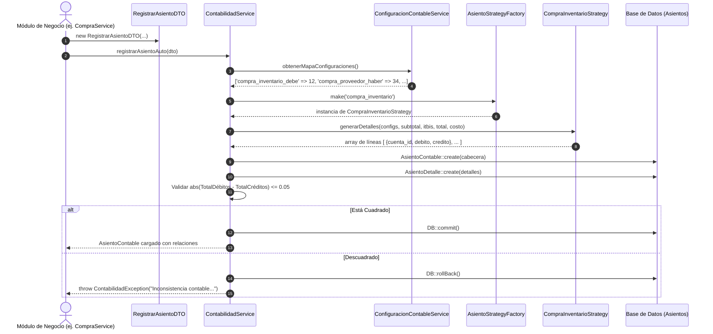

# 📖 Manual de Arquitectura y Funcionamiento del Motor Contable

> **Propósito de este documento:**  
> Servir como especificación técnica completa y guía de referencia definitiva para desarrolladores y **Agentes de IA**. Explica cómo funciona el motor contable automático por partida doble, cómo se registran las transacciones de ventas, compras, pagos y nóminas sin código duro (*Zero Hardcoded Accounts*), y las reglas obligatorias para extender o interactuar con el módulo.

---

## 📑 Tabla de Contenidos
1. [Filosofía y Arquitectura del Motor](#1-filosofía-y-arquitectura-del-motor)
2. [Estructura de Directorios del Módulo](#2-estructura-de-directorios-del-módulo)
3. [Componentes Principales](#3-componentes-principales)
4. [Catálogo de Claves de Configuración Dinámica](#4-catálogo-de-claves-de-configuración-dinámica)
5. [Ciclo de Vida de un Asiento Contable Automático](#5-ciclo-de-vida-de-un-asiento-contable-automático)
6. [Ejemplos Prácticos de Uso (Código Real)](#6-ejemplos-prácticos-de-uso-código-real)
7. [Cómo Agregar una Nueva Estrategia Contable](#7-cómo-agregar-una-nueva-estrategia-contable)
8. [Reglas Obligatorias para Agentes de IA (AI Prompts & Guidelines)](#8-reglas-obligatorias-para-agentes-de-ia)

---

## 1. Filosofía y Arquitectura del Motor

El motor contable de este sistema se basa en 4 pilares fundamentales de ingeniería de software y contabilidad financiera:

1. **Partida Doble Estricta (*Double-Entry Bookkeeping*):**  
   Toda transacción debe balancear matemáticamente:
   $$\sum \text{Débitos} = \sum \text{Créditos}$$
   Si la diferencia absoluta supera $0.05$ (tolerancia por redondeo de centavos), la transacción se revierte de inmediato mediante `DB::rollBack()` y se arroja una `ContabilidadException`.

2. **Cero Código Duro (*Zero Hardcoded Account IDs*):**  
   Ningún servicio ni controlador debe tener números de cuenta fijos en su código (ej. jamás escribir `cuenta_id = 4`). Las cuentas contables se resuelven dinámicamente desde la tabla `configuraciones_contables`, configuradas desde la interfaz de usuario en la pantalla **"Configuración Contable Automática"**.

3. **Patrón Estrategia (*Strategy Pattern*) + Factoría (*Factory*):**  
   Cada naturaleza contable (`compra_inventario`, `pago_compra`, `venta_efectivo`, `venta_credito`, `pago_nomina`, etc.) tiene su propia clase de estrategia que implementa la interfaz `AsientoStrategy`. La factoría `AsientoStrategyFactory` despacha la estrategia adecuada según el `tipo_transaccion`.

4. **Objetos de Transferencia Inmutables (*DTOs*):**  
   La comunicación entre los módulos de negocio (`Compra`, `Facturación`, `Nómina`, `Caja`) y el motor contable se realiza a través de `RegistrarAsientoDTO`.

---

## 2. Estructura de Directorios del Módulo

El módulo vive completamente encapsulado dentro de `backend/app/Modules/Contabilidad/`:

```text
backend/app/Modules/Contabilidad/
├── DTOs/
│   └── RegistrarAsientoDTO.php             # DTO de entrada inmutable para generar asientos
├── Exceptions/
│   └── ContabilidadException.php          # Excepción renderizable ante descuadres contables
├── Http/
│   ├── Controllers/
│   │   ├── ConfiguracionContableController.php # CRUD de mapeo dinámico de cuentas
│   │   ├── AsientoContableController.php       # Historial de asientos y asientos manuales
│   │   ├── CatalogoCuentaController.php        # Catálogo plan de cuentas
│   │   └── ReporteContableController.php       # Libro Diario, Mayor, Balance, Estado Resultados
│   └── Requests/
│       ├── UpdateConfiguracionContableRequest.php
│       ├── BulkUpdateConfiguracionContableRequest.php
│       └── StoreAsientoManualRequest.php
├── Services/
│   ├── ConfiguracionContableService.php    # Administrador del mapeo y validaciones
│   ├── ContabilidadService.php             # Motor central de registro de asientos
│   └── ReportesContablesService.php        # Generador de reportes contables
├── Strategies/                             # ⚡ Motor de Estrategias Contables (Partida Doble)
│   ├── AsientoStrategy.php                 # Interfaz base de estrategias
│   ├── AsientoStrategyFactory.php          # Factoría resolutoria de estrategias
│   ├── CompraInventarioStrategy.php        # Compras estándar, informales e inventario
│   ├── PagoCompraStrategy.php              # Pagos de CxP a proveedores
│   ├── VentaEfectivoStrategy.php           # Ventas de contado
│   ├── VentaCreditoStrategy.php            # Ventas a crédito (CxC)
│   ├── PagoCxcStrategy.php                 # Cobros a clientes
│   ├── PagoNominaStrategy.php              # Desembolsos de nómina
│   ├── PagoDgiiStrategy.php                # Declaraciones y pagos de impuestos
│   ├── DevolucionCompraStrategy.php        # Devoluciones a proveedores
│   └── DevolucionVentaStrategy.php         # Devoluciones de clientes
└── Routes/
    └── api.php                             # Rutas exclusivas del módulo bajo /api/v2/
```

---

## 3. Componentes Principales

### A. `ConfiguracionContableService`
Es el guardián de la configuración. Provee:
* `obtenerMapaConfiguraciones()`: Retorna un array clave-valor `['clave' => cuenta_id]` en memoria.
* `actualizar(id, cuentaId)` y `actualizarBulk(configs)`: Asigna cuentas contables asegurando que la cuenta seleccionada **permita movimiento** (`permite_movimiento = true`). Impide asignar cuentas padre/acumulativas.
* `validarClavesConfiguradas(array $claves)`: Revisa que todas las claves requeridas para una operación existan antes de ejecutar transacciones.

### B. `ContabilidadService`
Es el orquestador del motor contable:
* Inyecta `ConfiguracionContableService`.
* `registrarAsientoAuto(RegistrarAsientoDTO $dto)`:
  1. Carga el mapa de cuentas configuradas.
  2. Obtiene la estrategia con `AsientoStrategyFactory::make($dto->tipo_transaccion)`.
  3. Ejecuta `$strategy->generarDetalles(...)`.
  4. Crea `AsientoContable` (cabecera).
  5. Inserta los `AsientoDetalle` (débitos y créditos).
  6. Valida la partida doble.
  7. Retorna el asiento posteado con sus relaciones cargadas.
* `registrarAsientoManual(array $datos, array $detalles, ?int $usuarioId)`: Permite a contadores ingresar asientos manuales con validación previa de cuadre.

---

## 4. Catálogo de Claves de Configuración Dinámica

Estas claves residen en la tabla `configuraciones_contables` y se administran desde la UI:

| Grupo | Clave en Base de Datos | Nombre en UI | Naturaleza | Código Sugerido |
| :--- | :--- | :--- | :--- | :--- |
| **Compras** | `compra_inventario_debe` | Adquisición de Mercancía / Inventario | Débito | `1.1.05.01` (Inventario Alimentos) |
| **Compras** | `compra_proveedor_haber` | Obligaciones con Proveedores | Crédito | `2.1.01` (Cuentas por Pagar Proveedores) |
| **Compras** | `compra_itbis_debe` | ITBIS Adelantado en Compras | Débito | `2.1.02` (ITBIS por Pagar / Adelantado) |
| **Compras** | `itbis_retenido_por_pagar`| ITBIS Retenido por Pagar (Proveedores Informales) | Crédito | `2.1.03` (ITBIS Retenido por Pagar) |
| **Compras** | `pago_compra_efectivo_haber`| Pago a Proveedor en Efectivo/Banco | Crédito | `1.1.01.01` (Caja General) |
| **Ventas** | `venta_efectivo_debe` | Cobro de Ventas en Efectivo | Débito | `1.1.01.01` (Caja General) |
| **Ventas** | `venta_credito_debe` | Cobro de Ventas a Crédito | Débito | `1.1.03` (Cuentas por Cobrar Clientes) |
| **Ventas** | `venta_haber` | Ingresos por Ventas de Comida | Crédito | `4.1.01` (Ventas de Alimentos) |
| **Ventas** | `venta_itbis_haber` | ITBIS Recaudado por Ventas | Crédito | `2.1.02` (ITBIS por Pagar) |
| **Ventas** | `venta_costo_debe` | Costo de Ventas | Débito | `5.1` (Costo de Ventas) |
| **Ventas** | `venta_inventario_haber`| Salida de Inventario por Venta | Crédito | `1.1.05.01` (Inventario Alimentos) |
| **Nómina** | `nomina_gasto_debe` | Gasto de Sueldos y Nómina | Débito | `6.1` (Sueldos y Salarios) |
| **Nómina** | `nomina_pago_haber` | Banco de Desembolso de Nómina | Crédito | `1.1.01.03` (Banco Operativo) |
| **Impuestos**| `pago_dgii_itbis_debe` | Pago a la DGII (ITBIS por Pagar) | Débito | `2.1.02` (ITBIS por Pagar) |

---

## 5. Ciclo de Vida de un Asiento Contable Automático



---

## 6. Ejemplos Prácticos de Uso (Código Real)

### Ejemplo 1: Registro Contable al Guardar una Compra Estándar (Formal)

```php
use App\Modules\Contabilidad\Services\ContabilidadService;
use App\Modules\Contabilidad\DTOs\RegistrarAsientoDTO;

// En CompraService.php tras guardar la compra en base de datos:
$contabilidadService = app(ContabilidadService::class);

$dto = new RegistrarAsientoDTO(
    tipo_transaccion: 'compra_inventario',
    subtotal: 1000.00,
    itbis: 180.00,
    total: 1180.00,
    referencia: 'FAC-2026-0042',
    glosa: 'Compra de inventario s/factura FAC-2026-0042 - Distribuidora Hermanos Pérez',
    usuario_id: auth()->id(),
    custom_configs: [
        'es_informal' => false,
        'detalles' => $compra->detalles->toArray(), // Permite asignar cuentas contables específicas por línea de gasto
    ]
);

$asiento = $contabilidadService->registrarAsientoAuto($dto);
```

**Resultado contable generado:**
* **Débito:** `Inventario de Alimentos` por `$1,000.00`
* **Débito:** `ITBIS Adelantado en Compras` por `$180.00`
* **Crédito:** `Cuentas por Pagar Proveedores` por `$1,180.00`
* **Total Débito:** `$1,180.00` | **Total Crédito:** `$1,180.00` *(Asiento Cuadrado)*

---

### Ejemplo 2: Registro de Compra a Proveedor Informal (Retención 100% ITBIS)

Si un proveedor es informal (comprobante B11/E41), la ley exige retener el 100% del ITBIS. La deuda a pagarle al proveedor es solo el subtotal y el ITBIS se adeuda a la DGII:

```php
$dto = new RegistrarAsientoDTO(
    tipo_transaccion: 'compra_inventario',
    subtotal: 5000.00,
    itbis: 900.00,
    total: 5900.00,
    referencia: 'NCF-B1100000015',
    glosa: 'Compra de verduras proveedor informal Juan Pueblo (Retención ITBIS 100%)',
    usuario_id: auth()->id(),
    custom_configs: [
        'es_informal' => true,
    ]
);

$asiento = $contabilidadService->registrarAsientoAuto($dto);
```

**Resultado contable generado:**
* **Débito:** `Inventario de Alimentos` por `$5,000.00`
* **Débito:** `ITBIS Adelantado en Compras` por `$900.00`
* **Crédito:** `ITBIS Retenido por Pagar` por `$900.00` *(Pasivo con la DGII)*
* **Crédito:** `Cuentas por Pagar Proveedores` por `$5,000.00` *(Monto a pagar al proveedor)*
* **Total Débito:** `$5,900.00` | **Total Crédito:** `$5,900.00` *(Asiento Cuadrado)*

---

### Ejemplo 3: Registro de Pago a Proveedor (Cancelación de Cuenta por Pagar)

Cuando se registra un egreso o abono a una factura de compra en el módulo de Cuentas por Pagar (`CuentaPorPagarService`):

```php
$dto = new RegistrarAsientoDTO(
    tipo_transaccion: 'pago_compra',
    subtotal: 0.00,
    itbis: 0.00,
    total: 2500.00, // Monto efectivamente pagado
    referencia: 'PAGO-CXP-0089',
    glosa: 'Abono a factura FAC-2026-0042 mediante transferencia',
    usuario_id: auth()->id(),
    custom_configs: [
        // Si el pago se hizo por un banco específico, se puede sobrescribir dinámicamente:
        'pago_compra_efectivo_haber' => $cuentaBancariaContableId,
    ]
);

$asiento = $contabilidadService->registrarAsientoAuto($dto);
```

**Resultado contable generado:**
* **Débito:** `Cuentas por Pagar Proveedores` por `$2,500.00` *(Disminuye el pasivo)*
* **Crédito:** `Caja General / Banco Operativo` por `$2,500.00` *(Disminuye el activo)*

---

### Ejemplo 4: Registro de Venta de Contado en Caja

```php
$dto = new RegistrarAsientoDTO(
    tipo_transaccion: 'venta_efectivo',
    subtotal: 1200.00,
    itbis: 216.00,
    total: 1416.00,
    referencia: 'FACT-000105',
    glosa: 'Venta de alimentos mostrador orden #105',
    usuario_id: auth()->id(),
    costo: 450.00 // Costo de los ingredientes consumidos
);

$asiento = $contabilidadService->registrarAsientoAuto($dto);
```

**Resultado contable generado:**
* **Débito:** `Caja General` por `$1,416.00`
* **Crédito:** `Ventas de Alimentos` por `$1,200.00`
* **Crédito:** `ITBIS por Pagar` por `$216.00`
* *(Líneas adicionales automáticas de costo si $costo > 0):*
  * **Débito:** `Costo de Ventas` por `$450.00`
  * **Crédito:** `Inventario de Alimentos` por `$450.00`

---

## 7. Cómo Agregar una Nueva Estrategia Contable

Si el restaurante incorpora una nueva operación (por ejemplo: `ajuste_inventario_merma`):

1. **Crear la clase de estrategia** en `backend/app/Modules/Contabilidad/Strategies/AjusteInventarioMermaStrategy.php`:
   ```php
   namespace App\Modules\Contabilidad\Strategies;

   use Exception;

   class AjusteInventarioMermaStrategy implements AsientoStrategy
   {
       public function generarDetalles(array $configs, float $subtotal, float $itbis, float $total, float $costo = 0.0): array
       {
           $cuentaGastoMerma = $configs['merma_inventario_gasto_debe'] ?? null;
           $cuentaInventario = $configs['compra_inventario_debe'] ?? null;

           if (!$cuentaGastoMerma || !$cuentaInventario) {
               throw new Exception("Faltan cuentas configuradas para registrar la merma de inventario.");
           }

           return [
               ['cuenta_id' => $cuentaGastoMerma, 'debito' => $total, 'credito' => 0.00],
               ['cuenta_id' => $cuentaInventario,  'debito' => 0.00,  'credito' => $total],
           ];
       }
   }
   ```

2. **Registrarla en la Factoría** `backend/app/Modules/Contabilidad/Strategies/AsientoStrategyFactory.php`:
   ```php
   'ajuste_inventario_merma' => AjusteInventarioMermaStrategy::class,
   ```

3. **Agregar la clave en el seeder** `ConfiguracionContableSeeder.php` si requiere configuración por defecto en la base de datos.

---

## 8. Reglas Obligatorias para Agentes de IA

Cuando cualquier **Agente de IA** (o desarrollador) trabaje en este proyecto, debe adherirse estrictamente a las siguientes directivas:

1. ❌ **PROHIBIDO Hardcodear IDs:** Nunca uses números fijos como `cuenta_id = 1` o `cuenta_id = 5` en controladores, servicios o migraciones de datos transaccionales. Siempre consulta `ConfiguracionContableService` o `ConfiguracionContable::pluck('cuenta_id', 'clave')`.
2. ✅ **Usar Siempre `RegistrarAsientoDTO`:** Para disparar asientos automáticos desde cualquier módulo (`Compra`, `Pedido`, `Caja`, `CxP`, `CxC`), usa siempre la firma tipada de `RegistrarAsientoDTO` y llama a `ContabilidadService::registrarAsientoAuto($dto)`.
3. ✅ **Validar Cuentas de Movimiento:** Cualquier cuenta asociada a una configuración contable debe tener `permite_movimiento == true`. `ConfiguracionContableService` ya implementa esta validación; nunca la desactives.
4. ✅ **Rutas Exclusivas en V2:** Toda nueva ruta contable debe registrarse en `backend/app/Modules/Contabilidad/Routes/api.php` bajo el prefijo modular `/api/v2/`.
5. 🛡️ **Manejo de Transacciones Atómicas:** Si un método de negocio (como guardar compra o cobrar factura) genera un asiento, el asiento debe formar parte de la misma transacción o estar protegido para que si el asiento falla por descuadre, la operación de negocio no quede huérfana.
6. 🎯 **Mantener la Idempotencia:** Cuando un formulario reintenta registrar una compra o pago, respeta el `idempotency_key` del módulo emisor para no duplicar asientos en el libro diario.
